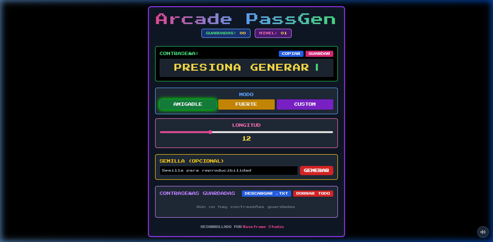
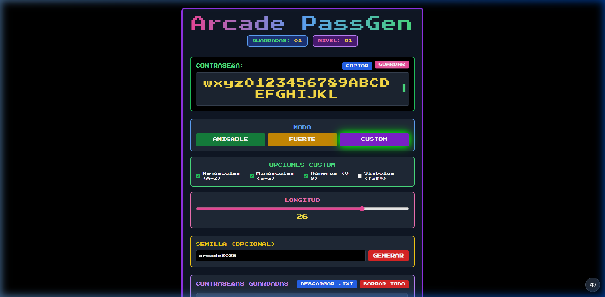
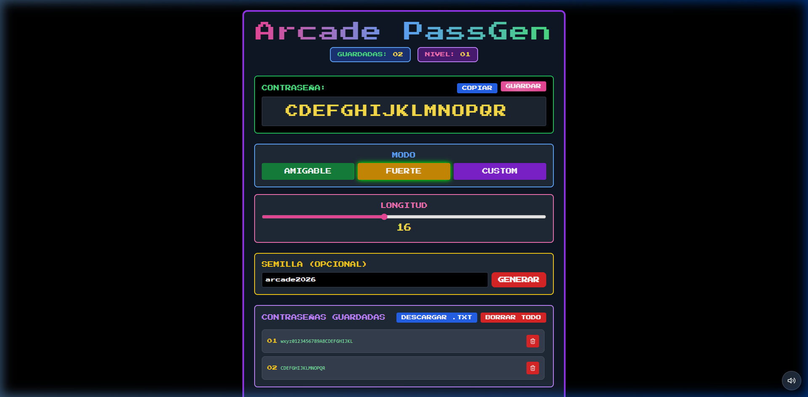

# 🕹️ Arcade PassGen — Generador de Contraseñas Retro 8-Bit



> Un generador de contraseñas potente, seguro y divertido con estética arcade de los 80, efectos de sonido chiptune (Web Audio API) y un elemento 3D interactivo impulsado por Three.js / React Three Fiber.

---

## 🌟 Características Principales

- 🕹️ **Estética Arcade Retro**: Interfaz neón 8-bit estilizada con fuentes pixeladas, efectos glowing y animaciones de escritura (typewriter effect).
- 🎲 **3 Modos de Generación**:
  - **Amigable**: Basado en palabras memorables en español combinadas con números y separadores.
  - **Fuerte**: Alta seguridad con combinaciones complejas de alta entropía.
  - **Custom**: Selección personalizada de Mayúsculas, Minúsculas, Números y Símbolos.
- 🔑 **Semillas Deterministas (Seed)**: Permite generar la misma contraseña ingresando una semilla o palabra clave para reproducibilidad sin necesidad de almacenarla en la nube.
- 🧊 **Header 3D Interactivo**: Renderizado 3D en tiempo real con **Three.js** y `@react-three/fiber`.
- 🎵 **Efectos de Sonido Chiptune**: Audio retro generado nativamente mediante la **Web Audio API** (con opción de silenciar).
- 🏆 **Sistema de Gamificación y Niveles**: Sube de nivel a medida que generas y guardas tus contraseñas seguras.
- 💾 **Gestor Local de Contraseñas**: Guarda tus credenciales en el navegador (`localStorage`), cópialas al portapapeles con un clic o expórtalas a un archivo de texto `.txt`.

---

## 🖼️ Capturas de Pantalla

### 1. Interfaz Principal & Modo Amigable


### 2. Modo Custom & Opciones Personalizadas


### 3. Historial de Contraseñas Guardadas & Exportación


---

## 🛠️ Tecnologías Utilizadas

- **Core**: [React 18](https://react.dev/) + [Vite 5](https://vitejs.dev/)
- **Estilos**: [TailwindCSS](https://tailwindcss.com/) + PostCSS + CSS Vanilla Custom
- **Gráficos 3D**: [Three.js](https://threejs.org/) + [@react-three/fiber](https://docs.pmnd.rs/react-three-fiber) + [@react-three/drei](https://github.com/pmndrs/drei)
- **Iconos**: [Lucide React](https://lucide.dev/)
- **Audio**: Web Audio API (Sintetizador Chiptune nativo)

---

## 🚀 Instalación y Uso Local

Sigue estos pasos para ejecutar el proyecto en tu máquina local:

### Requisitos Previos
- [Node.js](https://nodejs.org/) (Versión 18 o superior recomendada)
- `npm` o `yarn`

### Pasos

1. **Clonar o navegar al repositorio:**
   ```bash
   git clone https://github.com/tu-usuario/arcade-password-generator.git
   cd arcade-password-generator
   ```

2. **Instalar dependencias:**
   ```bash
   npm install
   ```

3. **Iniciar servidor de desarrollo:**
   ```bash
   npm run dev
   ```
   Abre [http://localhost:5173/](http://localhost:5173/) en tu navegador para ver la aplicación en funcionamiento.

4. **Compilar para Producción:**
   ```bash
   npm run build
   ```

---

## 📂 Estructura del Proyecto

```text
arcade-password-generator/
├── public/
│   └── 3D/             # Modelos 3D y assets estáticos
├── screenshots/        # Capturas de pantalla para la documentación
├── src/
│   ├── components/
│   │   └── RotatingLogo3D.jsx # Componente Three.js 3D
│   ├── App.jsx         # Lógica principal del generador y UI
│   ├── index.css       # Estilos globales y utilidades neón
│   └── main.jsx        # Punto de entrada de React
├── package.json
├── tailwind.config.js
└── vite.config.js
```

---

## 👨‍💻 Créditos

Desarrollado con ❤️ por **Waveframe Studio**.